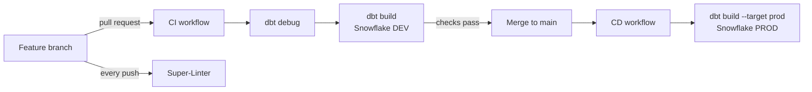

# CI/CD for dbt on Snowflake

* Even though this is a working repo, it might stop working after my Snowflake free trial expires.

A GitHub Actions pipeline that validates dbt changes in a **dev** Snowflake environment on every pull request and deploys them to **prod** on merge to `main`. Credentials come from GitHub Secrets, and the dbt profile is generated at runtime, so no secrets live in the repo.


## How it works



| Workflow | Trigger | What it does |
|---|---|---|
| [`ci.yml`](.github/workflows/ci.yml) | Pull request to `main` touching `src/dbt/**` | Writes a dev profile from secrets, runs `dbt debug`, then `dbt build` (seeds, models and tests in dependency order) against the dev database |
| [`cd.yml`](.github/workflows/cd.yml) | Push to `main` touching `src/dbt/**` | Same steps against the prod database (`--target prod`) |
| [`superlinter.yml`](.github/workflows/superlinter.yml) | Every push | Lints SQL, YAML, Python and Dockerfile |

Path filters mean the pipelines only run when dbt code actually changes.

## dbt project

A small medallion-style project used to exercise the pipeline:

```
src/dbt/
├── seeds/stg_developer.csv              # bronze: seeded source data
├── models/intermediate/inter_developer   # silver: renamed, typed, timestamped
├── models/mart/mart_developer            # gold: aggregated for reporting
└── macros/custom_demo_macros.sql         # custom schema naming + Snowflake query tags
```

- **Tests**: `unique` and `not_null` on keys and required columns at every layer.
- **`generate_schema_name`** override: models land in clean `intermediate` / `mart` schemas instead of `<target>_intermediate`.
- **`set_query_tag`**: tags every Snowflake query with the model name, so cost and query history can be traced back to a model.

## Setup

1. Add these repository secrets: `SNOWFLAKE_ACCOUNT`, `SNOWFLAKE_USERNAME`, `SNOWFLAKE_PASSWORD`, `SNOWFLAKE_ROLE`, `SNOWFLAKE_WAREHOUSE`, `SNOWFLAKE_SCHEMA`, `SNOWFLAKE_DATABASE` (dev) and `SNOWFLAKE_DATABASE_PROD`.
2. Protect `main` and require the CI check to pass before merging.
3. Open a PR that changes anything under `src/dbt/`.

### Run locally with Docker

```bash
docker build -t dbt-snowflake .
docker run -it -v ~/.dbt:/root/.dbt dbt-snowflake
# inside the container
dbt build
```

## Related

- [Datapipe_Process](https://github.com/GianottiLeo/Datapipe_Process): full Azure → Snowflake → dbt → Looker pipeline with a star schema.
